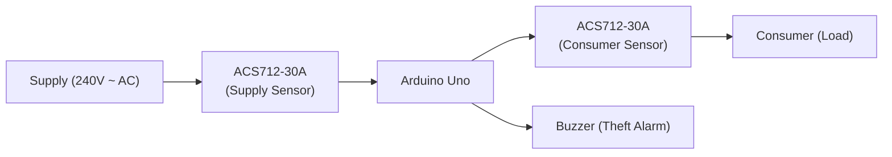
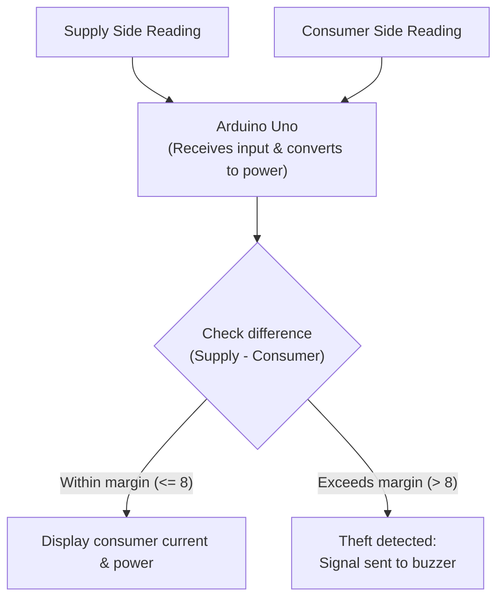

# Power-Theft-Detection-System

A dual-side Arduino-based system to detect electricity theft from the grid by comparing supply-side and consumer-side current consumption, alongside a GSM/LCD prepaid energy meter prototype.

> Full project report, hardware photos, and serial monitor test results are available in [`Content.pdf`](./Content.pdf) (Chapters 3–5).

---

## Hardware Components

### 1. Dual-Side Theft Detection (`Codes/Code2/Code2.ino`)
- **2x Arduino Uno** (Supply Side & Consumer Side)
- **2x ACS712-30A Hall-Effect Current Sensors** (2.1 kVRMS isolation, 66–185 mV/A sensitivity)
- **2x Junction Boxes** (240V AC Mains Supply & Consumer Load)
- **Breadboard & Jumper Wires**
- **Buzzer** (alerts when supply vs. consumer current discrepancy exceeds threshold)

### 2. Prepaid Energy Meter + Theft Switch (`Codes/Code1/Code1.ino`)
- **Arduino Uno**
- **16x2 LCD Display**
- **GSM Module** (SMS recharge & theft alert notifications)
- **Relay Module** (load cutoff when prepaid balance reaches 0)
- **Push-Button / Tamper Switch** (meter theft detection)
- **Buzzer**

---

## Pinout & Wiring

### `Codes/Code2/Code2.ino` (Current & Power Monitoring)
| Component | Arduino Uno Pin | Notes |
| :--- | :--- | :--- |
| ACS712-30A Output | `A0` | Samples 200 cycles to compute RMS current, RMS power (at 220V AC), and kWh |

### `Codes/Code1/Code1.ino` (Prepaid Meter & GSM Alerts)
| Component | Arduino Uno Pin | Notes |
| :--- | :--- | :--- |
| Pulse Input | `D2` | Interrupt `0` (`RISING`) for energy meter pulse counting |
| 16x2 LCD (`RS, E, D4, D5, D6, D7`) | `D3, D4, D5, D6, D7, D8` | Displays remaining units, price, and pulse count |
| GSM Module (`RX, TX`) | `D9, D10` | `SoftwareSerial(9, 10)` at 9600 baud |
| Buzzer | `D13` | Low balance / theft alert indicator |
| Theft / Tamper Switch | `A0` | `INPUT_PULLUP` (triggers `"Theft Alarm"` SMS when `LOW`) |
| Relay | `A5` | Controls consumer load power |

---

## System Block Diagrams

### Overall Architecture (Fig. 4.3 in `Content.pdf`)

### Theft Detection Flowchart (Fig. 4.4 in `Content.pdf`)

